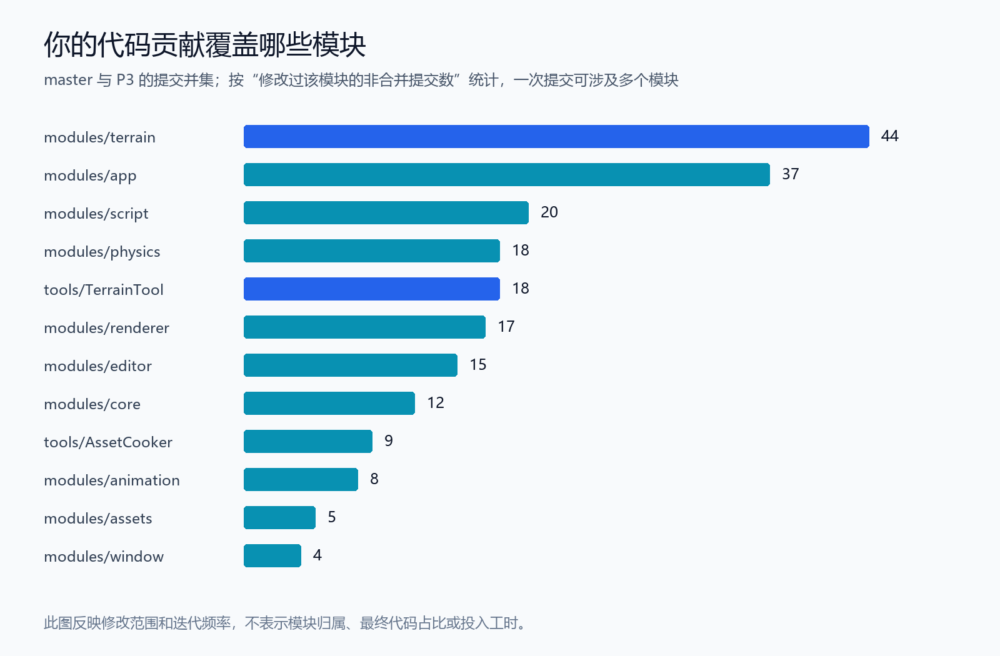
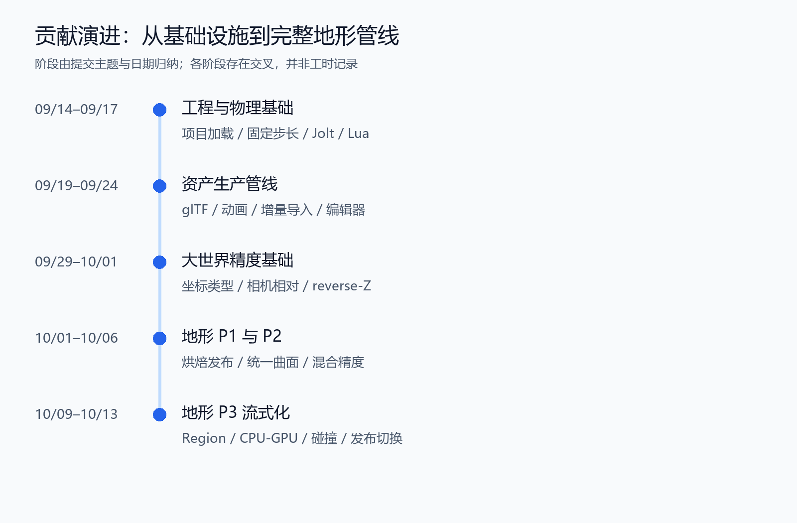

# Jackey Cen｜技术策划作品集：Mjolnir 引擎中的工具、玩法接口与地形管线

**项目类型：**团队自研 C++ 游戏引擎  
**个人工作方向：**内容制作工具、Lua 玩法接口、大世界精度与地形管线  
**作品集版本：**2026-10-15 导出，P3 代码基线为 `terrain-p3-final` / `ae8ef15`

[查看公开作品集代码](https://github.com/Littlecool9/GAM550Engine-Portfolio/tree/terrain-p3-final) · 原团队项目：GAM550F26/alpha

## 个人贡献概览

在 Mjolnir 团队引擎项目中，我参与实现了从内容输入、工具处理到运行时使用与验证的多项功能。我的主要工作是：将底层物理能力开放给 Lua 玩法脚本；建立 glTF 模型与动画的导入流程；完成大世界坐标相关改造；实现地形 P1–P3 从烘焙发布到运行时流式加载的管线。

这些经历与技术策划工作的连接点，是**把需求拆解为数据规则、制作流程、脚本接口和运行时约束，并提供可检查的结果与问题定位手段**。下面选取三个案例说明具体实现与取舍。

| 案例 | 面向的需求 | 我的实现范围 |
|---|---|---|
| 地形制作与运行时管线 | 地形数据能制作、发布并在运行时按需使用 | 烘焙校验、版本发布、统一曲面、LOD、流式驻留与版本切换 |
| 物理与 Lua 接口 | 玩法脚本能够查询环境并驱动物理行为 | 固定步长、Jolt 接入、施力与速度接口、射线查询、碰撞事件 |
| 模型与动画导入 | 外部模型能进入编辑器并用于场景 | glTF 导入、资产烘焙、动画播放接入、导入面板与增量处理 |

## 案例一：从地形制作输入到运行时流式加载

### 需求与问题

地形不仅需要被绘制出来，还需要被场景加载、被脚本查询，并为物理模拟提供碰撞。地形规模扩大后，还涉及不同精度数据的边界、加载预算，以及内容更新时如何保持当前场景状态一致。

我围绕这条链路推进了三个阶段的实现。

### P1：建立制作、发布与运行时的数据链路

- 增加地形 recipe、确定性生成器，以及 `TerrainTool bake` / `validate`，使地形输入能够转成可校验的资产。
- 建立版本化 tile pack、范围读取、不可变 release 发布、构建同步和打包流程。
- 定义统一的最终曲面，让高度查询、渲染网格与物理碰撞围绕同一曲面生成和使用数据。
- 接入场景地形实例、栅格与光追地形，以及 Jolt 静态高度场；进入 Play 后固定地形 release。

**对制作流程的价值：**地形有明确的输入、校验和发布步骤，场景中的可见结果、查询结果与碰撞也有共同的数据依据。

### P2：处理不同精度数据的衔接

- 增加稀疏 layer release 与逐 tile 源精度规则。
- 处理混合分辨率的最终边界，并生成最终曲面的 LOD 派生数据。
- 将混合精度结果接入栅格与光追，约束整实例碰撞的资源规模，向 Lua 开放驻留地形高度查询。

**核心取舍：**精度提高会增加数据和运行时成本。这里的工作重点是将精度规则落到数据处理与消费接口中，并处理边界，而不是单纯提高所有区域的采样密度。

### P3：将加载、渲染和碰撞拆成有预算的运行时过程

- 建立 Region 层级和逐 viewport 的 tile / Region LOD 选择。
- 通过 worker pool 与异步 streamer 处理地形 payload，管理 CPU 驻留预算。
- 在工作线程构建网格，接入 GPU 异步上传、驻留预算和延迟回收。
- 建立碰撞驻留与逐物理子步保护：相关地形碰撞未就绪时，暂缓对应动态 body 的推进。
- 更新地形 release 时，先后台校验与预热，再在安全时点接入；Play 期间继续使用固定版本。

**核心取舍：**可见性、数据驻留和碰撞就绪是不同状态。画面数据已经加载，并不意味着物理模拟可以直接前进；内容文件已经发布，也不意味着当前场景应立即切换版本。这些状态需要分别判断，再在明确的时点协调。

### 验证与观测

我提交了相关测试、Region 尺寸原型、流式路线探针、地形就绪与 GPU 帧观测，以及可重复执行的 benchmark，用于检查边界、资源状态和运行过程。该作品集说明依据提交历史整理，不附未经本次复测的帧率或性能提升承诺。

**代表性代码证据：**

| 内容 | 提交 |
|---|---|
| 烘焙校验与发布 | [TerrainTool bake / validate](https://github.com/Littlecool9/GAM550Engine-Portfolio/commit/7b25aa7)、[不可变 release 发布与同步](https://github.com/Littlecool9/GAM550Engine-Portfolio/commit/e94543c) |
| 多系统共用的曲面依据 | [canonical surface](https://github.com/Littlecool9/GAM550Engine-Portfolio/commit/49dda78)、[混合分辨率边界](https://github.com/Littlecool9/GAM550Engine-Portfolio/commit/7826215) |
| 选择与加载 | [逐 viewport LOD](https://github.com/Littlecool9/GAM550Engine-Portfolio/commit/23be8ec)、[CPU streamer](https://github.com/Littlecool9/GAM550Engine-Portfolio/commit/6cad8ed)、[GPU 驻留](https://github.com/Littlecool9/GAM550Engine-Portfolio/commit/f64d84d) |
| 状态与版本协调 | [物理子步保护](https://github.com/Littlecool9/GAM550Engine-Portfolio/commit/4291698)、[release 预热与安全切换](https://github.com/Littlecool9/GAM550Engine-Portfolio/commit/f2354c4) |
| 观测与验证 | [地形 benchmark](https://github.com/Littlecool9/GAM550Engine-Portfolio/commit/94a921b) |

## 案例二：把底层物理能力开放给玩法脚本

### 需求与实现

玩法原型需要检测周围环境、驱动物体，并对接触做出反应。我在物理与 Lua 之间补充接口，使这些操作可以通过脚本组织。

- 在系统调度中引入固定步长，接入 Jolt 与 ECS 中的 `RigidBody`、`PhysicsSystem`。
- 提供施力、力矩、冲量、线速度和角速度接口，支持在偏移位置施力。
- 建立物理 body 与 ECS entity 的关联，提供 `world:raycast` 查询。
- 增加碰撞 begin/end 事件与 `world:collisions`，使脚本能够读取接触信息。
- 另在团队主线提交了脚本消费地形碰撞事件的示例，连接底层事件与玩法反馈。

### 与玩法制作的连接

这些接口为环境检测、物理交互与碰撞反馈提供了基础。例如，射线查询可以作为交互目标检测的底层能力，碰撞事件可以作为触发脚本反馈的输入；这里展示的是接口与接入能力，尚不等同于完整交互系统或成品玩法。

**需要协调的约束：**脚本更新与物理子步的执行时机不同，body 的创建和销毁也需要与实体生命周期一致。接口能否调用，以及调用后何时生效，都依赖运行阶段。

**代表性代码证据：**[固定步长](https://github.com/Littlecool9/GAM550Engine-Portfolio/commit/507f431)、[Jolt 接入](https://github.com/Littlecool9/GAM550Engine-Portfolio/commit/06b7a63)、[Lua 物理接口](https://github.com/Littlecool9/GAM550Engine-Portfolio/commit/fef64ef)、[射线查询](https://github.com/Littlecool9/GAM550Engine-Portfolio/commit/29c6189)、[碰撞事件](https://github.com/Littlecool9/GAM550Engine-Portfolio/commit/9fb9059)。

补充说明：地形碰撞事件的脚本消费示例另在团队主线，本公开快照不包含该示例。

## 案例三：连接外部模型与编辑器的资产导入流程

### 需求与实现

外部模型进入引擎，需要经过格式解析、资产转换、运行时加载与场景呈现。内容迭代还需要明确哪些资产发生了变化，以及如何重新处理。

- 建立 glTF 导入与静态烘焙流程，连接模型资产、材质、运行时模型资源与动画播放。
- 增加模型 shader、动画求值与模型系统接入，并提交导入 fixtures 和测试。
- 增加编辑器导入面板与 `AssetImportManager`，使导入拥有编辑器操作入口。
- 引入资产 fingerprint 与增量 cook，为识别变化和增量处理提供依据。
- 后续整理动画模块边界，将模型播放系统迁入 animation 模块并改进接口。

### 对内容制作的价值

这项工作将模型文件转换、编辑器操作和运行时结果连接起来，为“导入—检查—修改—再次导入”的内容迭代提供工具基础。增量处理面向减少重复处理的需求；当前说明不将其量化为未经测量的效率提升。

**代表性代码证据：**[glTF 与动画导入管线](https://github.com/Littlecool9/GAM550Engine-Portfolio/commit/492b6bd)、[编辑器导入与增量 cook](https://github.com/Littlecool9/GAM550Engine-Portfolio/commit/90d80c9)、[动画模块整理](https://github.com/Littlecool9/GAM550Engine-Portfolio/commit/306c6c1)。

## 配套工作：大世界精度与跨系统适配

为支撑大范围场景，我还提交了世界坐标封装、Transform 精度改造、Lua 双精度向量、逐 viewport 相机相对渲染，以及编辑器相机、gizmo、picking、Jolt 和 Wwise 的精度适配；同时接入 reverse-Z 与构建精度开关。

这部分体现了我的跨系统工作方式：先明确世界坐标、局部坐标与渲染坐标的边界，再处理各消费系统的转换，避免不同系统各自采用不一致的位置表达。

**代表性代码证据：**[世界坐标类型](https://github.com/Littlecool9/GAM550Engine-Portfolio/commit/f24ffb8)、[Transform 精度改造](https://github.com/Littlecool9/GAM550Engine-Portfolio/commit/0255579)、[逐 viewport 相机相对提交](https://github.com/Littlecool9/GAM550Engine-Portfolio/commit/5ee3cc5)、[reverse-Z](https://github.com/Littlecool9/GAM550Engine-Portfolio/commit/53a9e72)。

## 贡献范围与团队协作

*图：按个人非合并提交涉及各区域的次数统计，一次提交可以涉及多个模块；次数不代表代码所有权或投入工时。*

*图：由提交日期与内容归纳的工作阶段，各阶段存在交叉。*

Mjolnir 是团队项目。我的个人贡献限定为上述接口、工具、管线与相关适配；ECS、Vulkan renderer、通用 UI、输入和窗口等基础能力包含其他成员的工作。合并其他成员 PR 的记录不作为我实现相关功能的依据。

截至本次统计快照，我在团队主线有 **64 条非合并提交**；作品集分支按已核对的两个作者邮箱归并，有 **113 条非合并提交**，另有 1 条相同姓名的本地邮箱提交未通过 GitHub 账号直接核实，未计入这里的个人数字。提交数量仅供查证参与记录，不作为工作量占比。

地形 P1 的代表提交已在统计的团队主线中；P2、P3 的上述代表提交保存在本次作品集分支。作品集快照为 `ae8ef15c0cd40af9a7d33d0826783ba05f82f996`，主线统计快照为 `06676c69cc46b75d68c14936605b6f76f3270a6e`。

## 可供进一步交流的主题

- **制作工具：**如何将地形、模型等内容输入转化为可校验、可发布的资产流程。
- **玩法接口：**如何确定脚本需要的查询、控制与事件能力，并处理运行阶段和生命周期约束。
- **系统取舍：**如何协调画面精度、资源预算、碰撞就绪与版本一致性。
- **验证方法：**如何通过测试、路线探针与观测数据定位跨系统问题。

以上案例主要体现技术实现、工具流程与系统分析经验。关卡体验、数值设计和成品玩法效果，需要结合其他作品另行展示。
