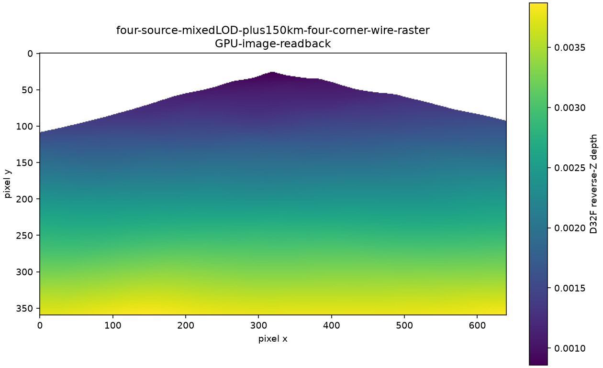
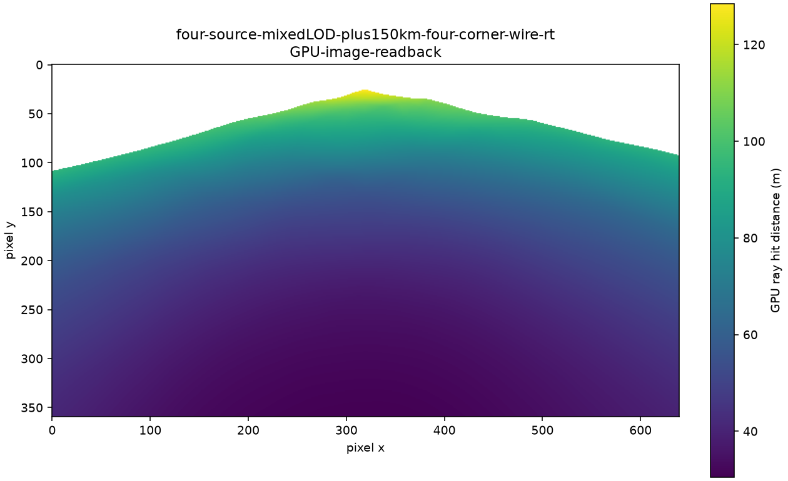

# 地形 P2 #122：混合源精度与混合 LOD 渲染

PR 描述：运行时从同一 release 独立读取烘焙 LOD 和法线，默认使用每个 tile 的源档；校验 release、源 checksum、拓扑、法线顶点顺序和原点后上传。公共边保持 #120 最终高度与 #121 烘焙边界，粗内部通过三角形连接环接入，没有 skirt。完整地形继续参与整帧光栅或光追。

补齐光追 PNG 抓取，增加真实 GPU D32F 深度与光追命中距离、法线的 float32 readback。独立 `TerrainRenderProbe` 使用相同运行时接口验证 1↔2/4/8 m、四角、不同 LOD、负 tile 坐标、部分边界、基本光照和雾，以及相机随地形移动的约 ±150 km 放置。线框由原始三角形展开后的重心坐标着色，不依赖 fillModeNonSolid 或重心扩展。

## 验证记录

四配置均显式 reconfigure、完整构建并运行全部 CTest。CPU 测试按 4 jobs 并行，GPU smoke 通过本次跨进程 mutex 串行执行，原 native 120 秒超时保留；没有删除注册项或缩减命令参数。各轮 fresh XML、inventory、Passed 状态和原生命令退出码 0 已核对。

| 配置 | 注册 | 通过 | 跳过 | 失败 / 禁用 | smoke | CTest 秒 |
|---|---:|---:|---:|---|---|---:|
| Debug | 733 | 733 | 0 | 0 / 0 | 7/7 | 1204.93 |
| Release | 733 | 733 | 0 | 0 / 0 | 7/7 | 126.15 |
| debug-float | 733 | 696 | 37 | 0 / 0 | 7/7 | 1267.57 |
| game-debug | 733 | 733 | 0 | 0 / 0 | 7/7 | 1105.65 |

debug-float 的 37 项跳过由既有 `MIR_LARGE_WORLD=OFF` 精度条件触发，包含仅验证 double 世界坐标的远处变换、查询、接触及 Lua 用例，未禁用测试。远处混合 TerrainCheck 的实际 float 加载另有以下生产验证。原始结果为本次 `builds/p2-evidence/<preset>/ctest.xml`、`inventory.json`、`test-state.json`、构建及测试日志；`final-summary.json` 校验结果为 `errors: []`。

实现已在 `2f22bdc` 冻结，合入总集成 `bafd620`，包含 #123 `1a6ef1a` 和 #144 `8cc5486`；499 个产品文件 SHA256 用于确认测试期间源码未变。独立渲染验收已完成 Release 160 个场景与 32 个剔面组合，退出码 0，73,728,000 个像素路径分别验证。原始 320 张地形 PNG、64 张剔面 PNG、float32 矩阵、recipe/packs、camera/layout/stage/device 元数据与 `summary.json` 保存于本次 `builds/p2-evidence/gpu-full-float-viewport-release/`（junction 到 E:/CodexTerrainP2/run-20261006/issue-122）。

| 测量 | 实际最大值 / 数量 |
|---|---|
| 光栅 / RT 各自 reverse-Z 参照误差 | 4.667704e-7 / 3.196004e-8 |
| RT 法线长度误差 | 1.788139e-7 |
| 距离残差 / 推导包络最大比值 | 0.832548 |
| 原始跨管线最大距离差 | 6.815470 m，内部轮廓可见面变化 |
| 原始跨管线 mask 差异 | 84 个：地图内部 12，外边界 72 |
| 两参照命中不同 primitive | 3576 个 |
| 两路径各自未预期缺失 / 多出命中 | 全部 0 |

每场景最多 3 个 raw mask 差异、51 个 primitive 覆盖变化；每个 mask 差异都记录坐标、地图内外、理想/量化节点，未排除像素。各自参照的距离残差最大 0.051630 m 属于浮点及逆投影数值测量，不能当作物理误差门槛的结果。

代表图均由真实 GPU 数据绘制：

第一幅单位为 D32F reverse-Z，第二幅单位为米，两幅颜色不能直接比较。已查看近地、远景、斜视、掠视、四角的真实 lit/wire PNG 与这两幅深度图，未看到公共边裂缝。光栅线框使用 `fwidth` 屏幕导数宽度且不施加 fog；RT 使用固定 0.025 重心宽度并沿用 hit fog，miss 采用现有大气天空，而工具光栅背景是 clear。颜色与线宽不要求像素相同；拓扑与接缝依据为 depth/mask 参照及共同边 bit 检查。

## 混合精度生产碰撞验证

集成依赖后，debug-float 的原生产 `MjolnirEngine --game games/TerrainCheck --frames 120` 退出码为 0。场景在 `(150000.5, -20, -75000.25)` 完整加载四个 terrain mesh 和一个 HeightField，asset `93f78444273cf162`，release `67f2c5e384f4fbe5`。没有禁用碰撞、减小 recipe 振幅或放宽 5 cm 门槛。

| 候选统一 spacing | 总高度误差界 | 选择结果 |
|---|---|---|
| 8 m | 1.567420985 m | 细化 |
| 4 m | 0.412315397 m | 细化 |
| 2 m | 0.185196028 m | 细化 |
| 1 m | 0.044749764 m | 接受，余量约 5.25 mm |

1 m 总界分解为几何 0.000006680 m、Jolt 量化 0.003929138 m、水平坐标误差 0.040790621 m、数值余量 0.000023325 m。原始日志保存在本次 `builds/p2-evidence/mixed-production-float-engine.log`；四配置完整 CTest 中的 `smoke.TerrainCheck` 也已通过。

## 接口与设计决定

- `ReadTerrainRenderMesh(handle, tile, optionalLayer)` 空 layer 选择唯一源层，显式 layer 必须存在且不细于源层。P2 的静态混合 LOD 由验收工具选择；P3 再引入每视口调度。
- `MakeTerrainRenderMesh` 重新编码并核对 indexed payload checksum，拒绝把同尺寸法线数组换序或把相同拓扑平移到另一原点。返回的 `TerrainTileMesh::samples` 为空，因为连接环不是规则采样网格；顶点、索引和包围盒才是渲染输入。
- 运行时渲染要求带 LOD/Normal 的 2.1 release；2.0 仍可被格式读取器读取，正常 sync 会重新烘焙当前派生格式。
- GPU 抓取显式请求时才创建 RGBA32F 光追诊断图；光栅深度支持 transfer-src，只有诊断帧保留深度 store。抓取会同步等待提交完成，适用于验收，不用于正常帧性能测量。
- `TerrainCheck` 从旧均匀 recipe 改为本次 1/8/2/4 m v2 partial-negative 原型，保持场景正常碰撞路径；已合入 #123 并完成生产 debug-float 加载验证。

## 风险和范围

公共边位置和法线一致不意味着接缝达到 C1。固定源档不解决移动中的 LOD 跳变；P3 需要按误差选择、预算驻留和安全替换。支持光追的设备仍会在 CreateMesh 同步建立每 tile BLAS，显存和上传成本继承现行架构。光追 payload 额外携带命中距离和法线，尚未单独测量寄存器及正常帧成本。当前矩阵属于小范围原型，不能外推为全地图常驻或 150 km 相机相对距离的毫米精度保证。

## GPU 数值差异与验收口径

实际 RTX 3070 Laptop GPU 的 `subPixelPrecisionBits=8`。早期 pixel (125,66) 的约 1.8 mm 距离差可由 1/256 像素坐标量化解释。另一次 6.4 m 差异来自真实 RT 背面剔除缺陷：此前所有 instance 禁用 face culling，primary ray 不剔面。现在 TLAS 和 primary ray 按材质 None/Back/Front/Both、CW/CCW 及镜像 determinant 与光栅一致；这也修正现有 RT 材质的剔面行为。32 个真实 GPU 组合回归全部通过。

近地 pixel (20,165) 则属于另一种情况：理想三角形 790 覆盖像素中心，量化后不覆盖，光栅命中较远的 267，真实距离相差约 6.815 m。混合 LOD 掠视 pixel (175,195) 的三角形 297 也出现合法轮廓覆盖变化，量化后该像素为背景。完整节点、覆盖、预测和原始 GPU 输入 SHA 保存在 `terrain-p2-122-numerical-evidence.json`；失败 readback 保留在本次 E 盘证据目录。

[Vulkan 三角形规则](https://docs.vulkan.org/spec/latest/chapters/primsrast.html)与[设备精度限制](https://docs.vulkan.org/spec/latest/chapters/limits.html)是判断依据。验收对**每一个像素**分别要求光栅 mask 等于设备量化几何最近面 mask，RT mask 等于原始几何最近面 mask；两路径各自 reverse-Z 误差小于 **2e-6**，missing/spurious 双向计数为零，法线长度误差小于 2e-5。还保留基于屏幕 depth 梯度、设备 quantum 和实际逆投影灵敏度的距离数值包络，包含原 64×float epsilon 项。公共边高度、法线和远处 camera-relative 顶点的 bit 一致检查保持。

原始跨路径深度、距离、mask 差异单独报告，理想/量化每个 mask 变化均保存屏幕节点和地图内外分布；不会把它们改写成原始一致。CPU 参照仅用于核对 GPU，PNG 和 `.depth.f32` 来自真实 GPU copy。独立 `prove_depth_oracles.py` 已核对 23 个实际场景的 10,598,400 个像素路径，全部满足各自 mask 与 2e-6；161 次错误深度、缺失命中、NaN、错误法线注入均被拒绝，旧真实 RT 剔面缺陷也被拒绝。结果和输入 SHA 保存在 `terrain-p2-122-oracle-proof.json`。

2e-6 是本次实现采用并经根复核保留的 GPU 门槛。物理 5 cm、0.3 m/s、5 mm 门槛沿用用户批准方案。亚像素内部轮廓、材质剔面与原始几何遍历的覆盖语义不同，不能宣称两路径全部像素命中同一三角形。float32 viewport 运算和量化 ties-to-even 在本次设备实测成立；严格逐像素参照是本机 RTX 回归范围，Vulkan 允许的 clip/viewport/subpixel 实现差异仍需跨设备验证。其他 GPU 仍需真实 readback 验证其量化行为。当前镜头为 near=0.1、far=10000，RT TMin=0.001；此矩阵未覆盖近裁剪面内的相交几何。
